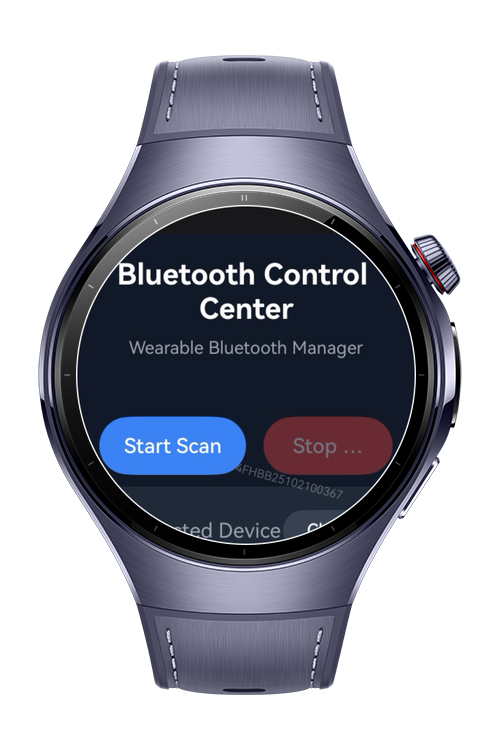
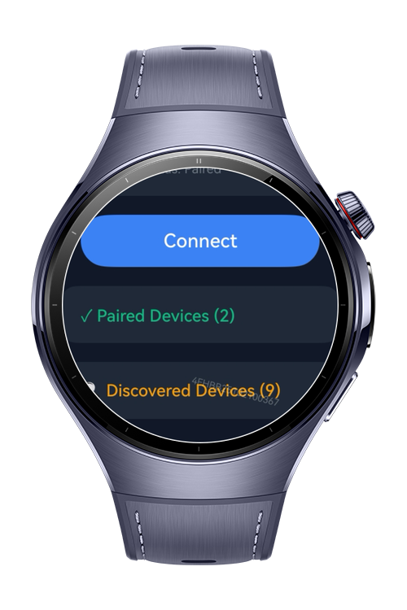
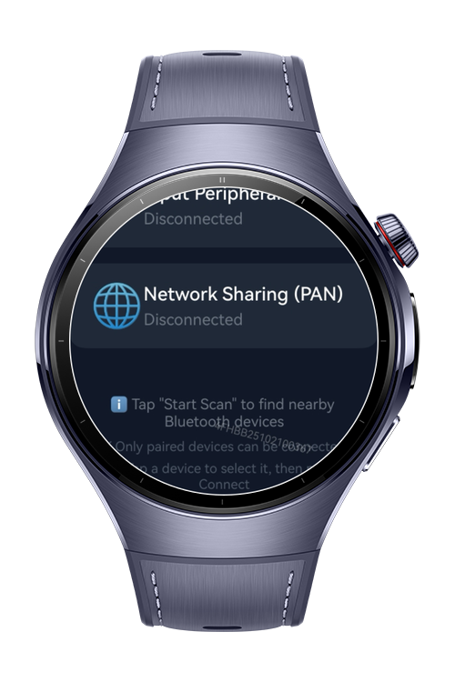
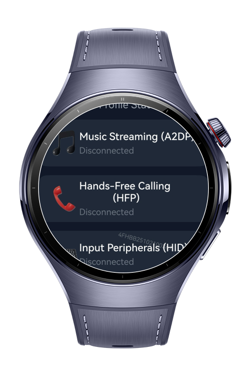

> **Note:** To access all shared projects, get information about environment setup, and view other guides, please visit [Explore-In-HMOS Index](https://github.com/Explore-In-HMOS/hmos-index).

# How To Build Bluetooth Device Dashboard

A comprehensive Bluetooth management application for OpenHarmony wearable devices that demonstrates the usage of Connectivity Kit Bluetooth profiles including A2DP (audio streaming), HFP (hands-free calling), HID (input devices), and PAN (network tethering).

# Preview
<div>
   
  
  
  
</div>

# Use Cases
- Discover Nearby Bluetooth Devices – User can tap "Start Scan" to find and list all available Bluetooth devices in range
- View Paired Devices – Display all previously paired devices from system settings with their pairing status
- Connect to Wireless Headphones for Music Streaming (A2DP) – Establish A2DP profile connection to stream high-quality audio
- Connect to Car Kit for Hands-Free Calling (HFP) – Enable hands-free calling profile for vehicle integration
- Connect to Bluetooth Keyboard/Mouse (HID) – Pair and use Human Interface Device peripherals
- Share Internet Connection via PAN – Establish Personal Area Network for tethering
- Monitor Real-Time Connection Status – View live connection states for each profile with color-coded indicators
- Disconnect Individual Profiles – Disconnect specific profiles without affecting others
- Select Device from Discovered List – Choose any paired device from the discovered devices list to connect

# Tech Stack

- **Languages**: ArkTS, TypeScript
- **Frameworks**: HarmonyOS SDK 5.1.0(18)
- **Tools**: DevEco Studio Version 5.1.0.842
- **Libraries**: @kit.ConnectivityKit, @kit.AbilityKit, @kit.BasicServicesKit
- **Bluetooth Profiles**:	A2DP, HFP, HID, PAN

# Directory Structure
```
entry/src/main/ets/
├── entryability/
│   └── EntryAbility.ets              # Application entry point
├── pages/
│   └── Index.ets                     # Main UI (device list, profile cards)
├── managers/
│   └── BluetoothManager.ets          # Core Bluetooth logic (singleton)
└── components/
    └── ProfileCard.ets               # Reusable profile status card

```

# Constraints and Restrictions

## Supported Device
- Huawei Watch 5

## Limitations

Bluetooth Profiles	        | A2DP, HFP, HID profiles are managed together via connectAllowedProfiles(); individual profile connection is not supported
Pairing	                    | Device pairing must be done through system settings; in-app pairing is not implemented
Discovery Duration	        | Bluetooth scanning lasts approximately 12-15 seconds per session
Permissions                 | Only ACCESS_BLUETOOTH is required; MANAGE_BLUETOOTH is a system-level permission and cannot be used
Disconnect API	            | disconnect() method may be limited on some API versions; use system settings as fallback

# LICENSE

`How to Build Bluetooth Device Dashboard` is distributed under the terms of the MIT License.
See the [LICENSE](./LICENSE) for more information.